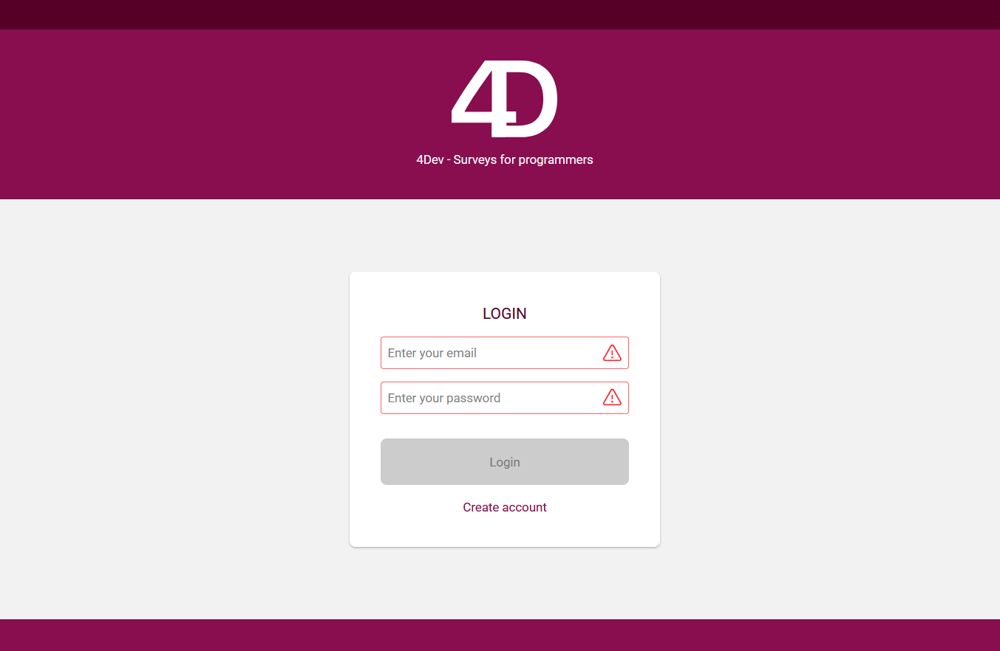
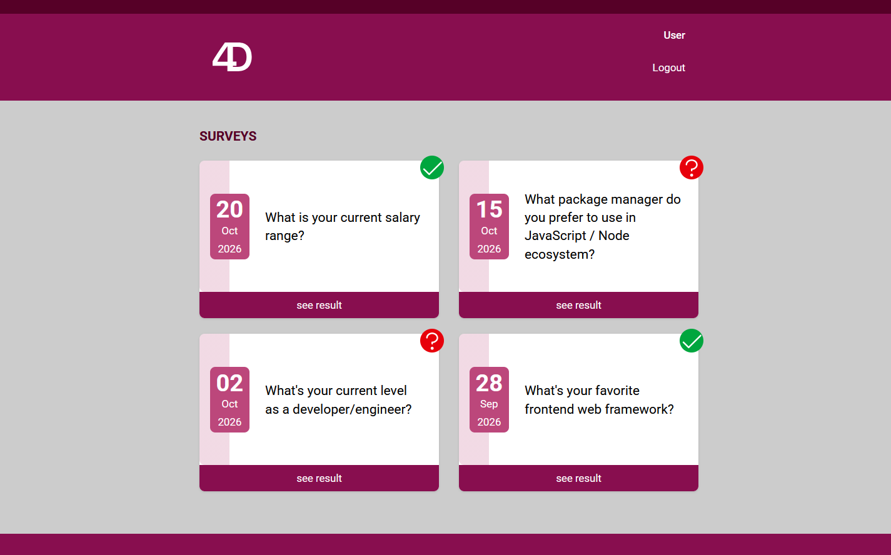
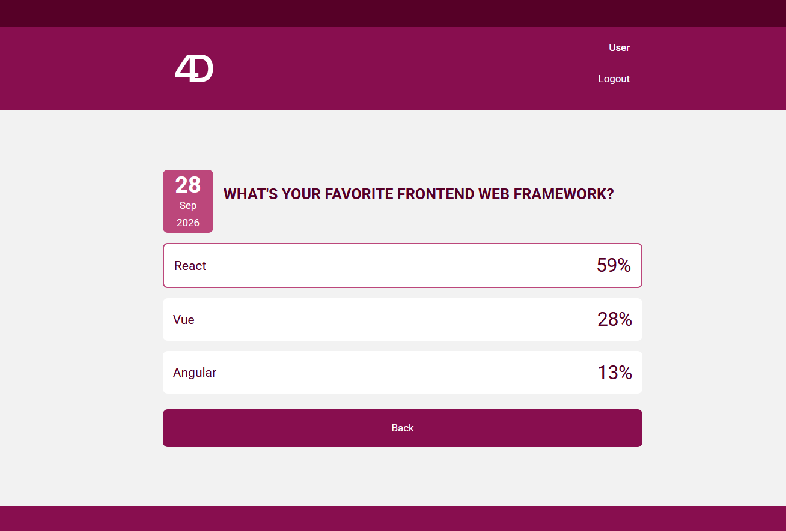

# **4Dev React - Surveys For Developers **

The goal of this project is to practice building a system in ReactJS using modern technologies integrated into a well-defined, decoupled architecture. It employs TDD (Test-Driven Development) as a working methodology and Clean Architecture to distribute responsibilities across layers, while consistently adhering to SOLID, DRY, YAGNI, and KISS principles, and applying design patterns to address common challenges.
<br /><br />

> ## Principles

* Single Responsibility Principle (SRP)
* Open Closed Principle (OCP)
* Liskov Substitution Principle (LSP)
* Interface Segregation Principle (ISP)
* Dependency Inversion Principle (DIP)
* Separation of Concerns (SOC)
* Don't Repeat Yourself (DRY)
* You Aren't Gonna Need It (YAGNI)
* Keep It Simple, Silly (KISS)
* Composition Over Inheritance
* Small Commits

> ## Design Patterns

* Factory
* Adapter
* Composite
* Decorator
* Dependency Injection
* Composition Root
* Builder
* Proxy
* Compound Components

> ## Methodologies and Designs

* TDD
* Clean Architecture
* DDD
* Reactive Programming
* Responsive Layout
* Conventional Commits
* GitFlow
* Modular Design
* Dependency Diagrams
* Use Cases
* Continuous Integration
* Continuous Delivery
* Continuous Deployment

> ## Frameworks, Libs and Tools

* Typescript
* React
* Context API
* Tanstack Query
* Tanstack Router
* Jest/Vitest
* React Testing Library
* Playwright
* Axios
* Git
* Vite
* Tailwind CSS
* NPM
* Node
* Express
* Faker
* Husky
* Lint Staged
* Eslint
* Standard Javascript Style

> ## Typescript Features

* POO Avançado
* Interface
* Type Alias
* Module
* Utility Types
* Modularização de Paths
* Build
* Deploy
* Generics

> ## Test Features

* Unit Tests
* Integration Tests
* E2E Tests
* Test Coverage
* Test Doubles
* Mocks
* Stubs
* Spies
* Fakes
* Dummies

## Demo Images




## :file_folder: How to run the project

Prerequisites: node.js, npm

```bash
# Clone repository
git clone https://github.com/KlevertonOliveira/surveys-4dev.git

# Enter project folder
cd surveys-4dev/

# Install dependencies
npm install

# Create a .env file in project's root and fill it following the template in .env.example file:
VITE_API_URL="http://localhost:3001/api"

# Run the project (in the root directory of the project!!!)
npm start
```

---

## :raising_hand_man: Author

**Kleverton Oliveira**

https://www.linkedin.com/in/klevertonoliveira/

---